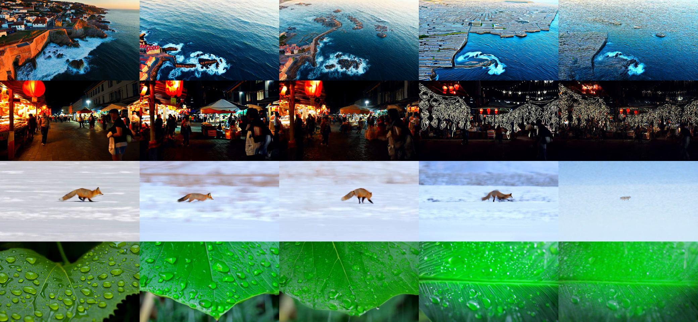

# Reference-free quality protocol, L4 (2026-11-14)

Predictions: `predictions_quality_2026-11-13.md`. Notebook: `colab/07_quality.ipynb`. Each configuration has 4 prompts × 4 seeds = 16 videos at 33 frames, on compile + Sage fp16-PV, all in one session.

**Result: 2 of the 8 predictions decided so far held; Q7, the blind test, is pending.**
- **Positive control works.** The metrics clearly see the known break: cache 0.20 is "worse" on CLIP text score, aesthetic and temporal consistency.
- **Neither candidate is shown "not worse" than 50 steps.** Both 20 steps and cache 0.10 lose CLIP text score, mostly on one prompt.
- **Cache 0.10 beats 20 steps** on CLIP text score at about the same speed.
- **10 steps visibly breaks videos,** and two of the metrics miss it. The aesthetic predictor doesn't move. The "sharpness" metric goes *up*, because what it measures turns out to be artifacts.

## Verdicts

| # | Prediction | Measured | |
|---|---|---|---|
| Q1 | seed 0 reproduces the earlier runs bit for bit | **0 of 16** (details below) | ✗ |
| Q2 | cache 0.20 "worse" on aesthetic and on clip_text or sharpness | aesthetic −4.8 SD, clip_text −6.0 SD, consistency −2.4 SD: all "worse" | ✓ |
| Q3 | 20 steps "not worse" on all four judged metrics | clip_text −1.72 (−2.5 SD) unclear; aesthetic unclear; consistency and sharpness not worse | ✗ |
| Q4 | 10 steps "worse" on aesthetic or sharpness | aesthetic −0.3 SD (unclear); sharpness **+7.3 SD**. It is "worse" on clip_text (−5.0 SD) instead | ✗ |
| Q5 | cache 0.10 "not worse" on clip_text and consistency; its sharpness change below 20 steps' | clip_text unclear (−1.1 SD); consistency not worse; sharpness +163 vs +474 ✓ | ✗ |
| Q6 | motion: cache 0.20 more than 1 SD below base; 20 steps within ±1 SD | −0.24 SD; +0.01 SD | ✗ |
| Q7 | blind test, base preferred: vs 20 steps 35–65%, vs cache 0.10 35–65%, vs cache 0.20 ≥ 80% | pending (`results/blind_ab/`) | – |
| Q8 | speed as in `L4_step_cache.md` | 50 steps 147.2 vs 147.4 s; 20 steps 65.7 vs 65.9 s; cache 0.10 computes 34.0% (seed 0 earlier: 34%), 0.20 18.5% (18%). 10 steps had no earlier run | ✓ |
| Q9 | seed SD: clip_text 0.8–2.0, aesthetic 0.08–0.25 | **0.69**, 0.108 | ✗ |

### Q1: seed 0 did not reproduce

None of the 16 seed-0 videos matches the earlier runs, although torch, diffusers, transformers, SageAttention (commit d1a57a5) and every option except `--seeds` are the same.
- **The change is real, not a rounding-level wobble.** Decoded mp4s of the same video differ by 26–34 dB; this is a diagnostic only, since mp4 adds its own error.
- **The cache's decisions moved too.** Fox seed 0 at 0.10 computes 32 forwards, where it computed 34 before.
- **The seed loop is not the cause.** It builds the generator the same way, and seed 0 runs first.
- **Likely causes, not recorded:** a change in the Colab image (driver, or the nvcc that builds SageAttention), or Inductor's runtime autotuning picking a different kernel config. The reports don't record either.

Every configuration here ran in the same session, so the paired comparisons are unaffected. Across sessions, though, the same configuration and seed can give a different video. The next notebook should record the driver, nvcc and Triton versions.

## Speed (16 videos each)

| | Wall per video | vs 50 steps | Forwards computed |
|---|---|---|---|
| 50 steps | 147.2 s | 1.00× | 100 |
| 20 steps | 65.7 s | 2.24× | 40 |
| Cache 0.10 | 61.5 s (58.7–65.2) | 2.39× | 34.0 (32–37) |
| 10 steps | 38.3 s | 3.84× | 20 |
| Cache 0.20 | 41.2 s (38.9–44.4) | 3.57× | 18.5 (17–21) |

## Metrics

Paired with 50 steps by prompt and seed (`quality_table.json`). The scale is 50 steps' seed SD within prompts. Verdicts use a 95% bootstrap CI and a margin of 1 seed SD.

| vs 50 steps | clip_text (SD 0.69) | aesthetic (SD 0.108) | clip_consist (SD 0.0063) | sharpness (SD 305) |
|---|---|---|---|---|
| 20 steps | −1.72 [−3.20, −0.49] unclear | +0.02 [−0.12, +0.15] unclear | +0.0006 not worse | +474 not worse |
| Cache 0.10 | −0.77 [−2.09, +0.38] unclear | −0.06 [−0.17, +0.05] unclear | −0.0021 not worse | +163 not worse |
| 10 steps | −3.45 [−5.26, −1.81] **worse** | −0.03 [−0.17, +0.08] unclear | −0.0066 unclear | +2,214 "not worse" |
| Cache 0.20 | −4.14 [−6.37, −2.00] **worse** | −0.52 [−0.70, −0.36] **worse** | −0.0148 **worse** | +1,225 "not worse" |

Cache 0.10 against 20 steps directly (base 20 steps): clip_text **+0.95 [+0.08, +1.93]**; aesthetic −0.08 [−0.23, +0.11]; consistency −0.0027 [−0.0051, −0.0004].

CLIP text score per prompt, mean over 4 seeds:

| | Fox | Coast | Leaf | Market |
|---|---|---|---|---|
| 50 steps | 32.9 | 29.2 | 26.8 | 29.4 |
| 20 steps | 31.5 | **24.4** | 27.0 | 28.7 |
| Cache 0.10 | 34.3 | **25.5** | 26.8 | 28.7 |
| 10 steps | 32.4 | 22.4 | 24.1 | 25.7 |
| Cache 0.20 | 30.6 | 22.4 | 24.1 | 24.7 |

`figures/quality_grid_last_frame.png`: last frames, from the mp4s, for viewing only. Columns: 50 steps, 20 steps, cache 0.10, 10 steps, cache 0.20. Rows: coast seed 1, market seed 2, fox seed 2, leaf seed 1.

## What the metrics show

- **CLIP text score is the most useful of the five.** It ranks the configurations in the order the frames suggest: 50 steps, cache 0.10, 20 steps, then 10 steps and cache 0.20. It is also the only metric that flags 10 steps.
- **The coastal-town prompt drives most of the loss at 20 steps and cache 0.10.**
  - At 20 steps, seed 1 loses 9.6 points.
  - In the grid, both drift toward open sea with only a corner of the town, where 50 steps shows the town.
  - The other three prompts lose little or nothing.
- **20 steps is also less consistent across seeds.** Its CLIP seed SD is 2.24, against 0.69 at 50 steps.
- **The aesthetic predictor misses the 10-step breakage.** The grid shows a maze texture on the coast, white line-art outlines over the market, and a striped, oversaturated leaf. The aesthetic score is still within 0.3 SD of 50 steps. It does catch cache 0.20, whose output is washed out and soft.
- **"Sharpness" measures artifacts, not detail.**
  - On coast and market it rises 2–8× with fewer steps, because of the high-contrast artifacts.
  - On fox and leaf it falls.
  - It is dropped as a quality score. A large *rise* in it can still serve as an artifact warning.
- **Motion doesn't change measurably** for any configuration. Its seed SD (3.0) is 64% of its mean.

## What this means so far

- **Out:** 10 steps and cache 0.20. Both break videos visibly and on CLIP.
- **Between cache 0.10 and 20 steps, the cache wins** on prompt alignment (+0.95 CLIP) at slightly higher speed (2.39× vs 2.24×). This reverses the preliminary read in `L4_step_cache.md`, which had seen no advantage from seed 0 alone.
- **Neither is shown to match 50 steps.** The loss is concentrated on one prompt out of four, so 4 prompts are too few to say how general it is.
- **The blind test** (Q7) is the remaining check on whether a person sees the difference.

## Files

- `q_steps50/`, `q_steps20/`, `q_fbc010/`, `q_steps10/`, `q_fbc020/`: each has `report.json` (per-video timing, cache log, seed), `quality.json` (per-video metrics) and `frames_sha256.json`, plus 16 mp4s.
- `quality_table.json`: the paired table above.
- `blind_ab/`: the blind page (`index.html`). The run mapping (`key.json`) is committed only after the test.
