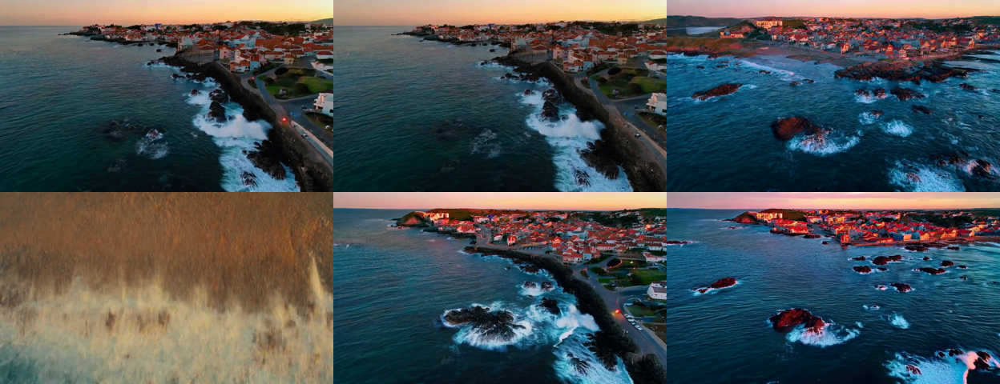

# Step caching (first-block cache) vs fewer steps, L4 (2026-11-13)

Predictions: `predictions_stepcache_2026-11-13.md`. Notebook: `colab/06_step_cache.ipynb`. Base: per-block fullgraph compile + SageAttention INT8 QK / fp16 PV, 50 steps, CFG 5.0, seed 0, 480×832. All runs were in one session.

**Result: 2 of 9 predictions held.**
- **Skipping:** the cache skips far more than I predicted. 43% of forwards at threshold 0.05, 66% at 0.10 and 82% at 0.20.
- **Cost of a skipped forward:** as modeled, about 5% of a full one.
- **Quality:** every threshold above 0.05 produces a *different video*, not a slightly worse one.
- **Fewer steps** also produces a different video: 30 steps lands 16.6 dB from the 50-step output.
- **The main finding is about measurement, not caching.** Once an optimization changes the sampling trajectory, PSNR to a 50-step reference no longer measures quality. The project needs a reference-free quality check before it can rank caching against fewer steps.

## Verdicts

| # | Prediction | Measured | |
|---|---|---|---|
| C1 | uncached fp16-PV reproduces `sage_fp16pv_33f` | 4 of 4 identical | ✓ |
| C2 | skipped: 0.05 → 10–35%, 0.10 → 30–55%, 0.20 → 45–70% | **43%, 66%, 82%** | ✗ |
| C3 | transformer time = T₀((1 − s) + k·s), k in 0.03–0.08 | k = 0.040–0.064 on all 16 cached videos | ✓ |
| C4 | PSNR to uncached: 0.05 ≥ 26 dB; 0.10 in 20–30; 0.20 in 15–25 | 22.9–29.4; 13.6–18.2; 9.6–16.8 | ✗ |
| C5 | vs fp32: 0.05 and 0.10 meet the bar (fox ≥ 27.1, market ≥ 22.8); 0.20 fails | 0.05: fox **23.0**, market 23.1; 0.10: 18.2 / 13.5; 0.20 fails | ✗ |
| C6 | at matched compute, cache ≥ 2 dB closer to the 50-step output than fewer steps | 0.05 (57% computed) vs 30 steps: +8.3 dB; 0.10 (34%) vs 20 steps: **+0.7 dB** | ✗ |
| C7 | no skips in steps 0–4; last third skips at least as often as the first | skips from step 1 at 0.10 and 0.20; first third skips more at every threshold | ✗ |
| C8 | 81 f at 0.10: skipped within 10 points of 33 f; PSNR 0–5 dB below the 33 f mean | 66% vs 66% ✓; PSNR 17.9 vs 15.4, **2.5 dB above** | ✗ |
| C9 | CLIP within ±0.5 of uncached for every run | 0.20: **−2.12**; 30 steps: **−0.53**; others within | ✗ |

## Speed

| 33 f, mean of 4 videos | Forwards computed | Transformer per video | Wall per video | Speedup (wall) |
|---|---|---|---|---|
| Uncached, 50 steps | 100 | 136.2 s | 147.4 s | 1.00× |
| Cache 0.05 | 57 | 80.2 s | 91.4 s | 1.61× |
| Cache 0.10 | 34 | 50.6 s | 61.8 s | 2.39× |
| Cache 0.20 | 18 | 29.8 s | 41.0 s | 3.60× |
| 30 steps | 60 | 82.1 s | 93.3 s | 1.58× |
| 20 steps | 40 | 54.9 s | 65.9 s | 2.24× |

| 81 f fox | Transformer | Wall | Speedup |
|---|---|---|---|
| Uncached (fp16-PV) | 442.3 s (4,423 ms per forward) | 469.6 s | 1.00× |
| Cache 0.10 (34 computed) | 162.2 s | 189.5 s | 2.48× |

- **Skip cost.** A skipped forward costs k ≈ 0.05 of a full one (C3). That is block 0 plus the embeddings, the output projection and the fp32 residual bookkeeping. At 0.10 the skips still take about 9% of the transformer time.
- **Memory.** The cache's fp32 residuals add 0.43 GB of peak memory at 33 f and 1.0 GB at 81 f.
- **fp16-PV at 81 f, measured for the first time.** Its forward is 4,423 ms, against compile's 5,280 ms in the previous session. That is 1.19×, matching the 1.18× estimated in `L4_sage.md`.

## When the cache skips

The decision log of each forward is in `report.json` (`runs[i].cache.log`). Fox at 0.10, step 0 to 49, `.` = computed, `x` = skipped:

```
cond    .x.xx.xxx.xxxx.xxxxx.xxxx.xxxx.xxx.xx.xx.x.x.x....
uncond  .x.xx.xxx.xxxx.xxxxx.xxxx.xxxx.xxx.xx.xx.x.x.x....
```

- **Steps 0–4 skip as soon as there is something to compare against** (C7 is wrong there). From one step to the next, block 0's residual changes by only 3–9% (relative mean absolute difference) through most of the run: 0.076 at step 1, 0.031 at step 5. It rises at the end: 0.10 at step 47 and 0.19 at step 49. A threshold of 0.05, diffusers' default, therefore sits inside the change of a single step. It skips roughly every other step through the middle of the run.
- **The most skipping happens early.** Skips are densest in the first half, where the residual's relative change per step is smallest. At 0.05 and 0.10 the last 4–11 steps are always computed. At 0.20 every other step is skipped right to the end.
- **The two CFG branches agree.** Cond and uncond made the same decision at 645 of 650 steps. One decision for both would change almost nothing.

## Quality

Pixel metrics are computed from the exact frames (npy).

| 33 f | PSNR to uncached (fox / coast / leaf / market) | LPIPS | To fp32: fox / market | CLIP (Δ vs uncached) |
|---|---|---|---|---|
| Uncached | – | – | 35.4 / 26.6 | 29.65 |
| Cache 0.05 | 22.9 / 29.4 / 24.1 / 23.2 | 0.06–0.15 | 23.0 / 23.1 | −0.13 |
| Cache 0.10 | 18.2 / 15.7 / 14.2 / 13.6 | 0.32–0.56 | 18.2 / 13.5 | −0.05 |
| Cache 0.20 | 16.8 / 9.6 / 13.4 / 11.8 | 0.42–0.92 | 16.6 / 11.7 | **−2.12** |
| 30 steps | 19.4 / 17.0 / 15.2 / 14.7 | 0.19–0.50 | 19.6 / 14.5 | −0.53 |
| 20 steps | 17.9 / 14.5 / 12.9 / 13.4 | 0.30–0.58 | 17.9 / 13.3 | −0.11 |

For scale (`L4_noise_floor.md`): changing the seed gives 9.6–13.0 dB. Compile vs eager is 25–30 dB. An exact kernel swap is 36 dB.



`figures/stepcache_video{0..3}_last_frame.png` show the last frame of each run. Top row: uncached, cache 0.05, cache 0.10. Bottom row: cache 0.20, 30 steps, 20 steps. They are taken from the mp4s, for viewing only.

- **Cache 0.05** keeps the scene and composition of the 50-step video and changes details: the fox's stride, the lantern positions. It sits a little further from the uncached output (mean 24.9 dB) than compile sat from eager (25–30 dB).
- **Cache 0.10, 30 steps and 20 steps** each produce a different, clean video of the same prompt. On the coast, the market and the leaf they choose a different framing. Cache 0.10 and 20 steps often pick the *same* framing as each other: the red rocks on the coast, the lantern strings over the market. This fits the cache acting like a coarser schedule: at 0.10 it computes 17 of 50 steps.
- **Cache 0.20 breaks.**
  - The coast video collapses into a blurred close-up of a wave (CLIP drops from 28.1 to 20.7, LPIPS 0.92).
  - The leaf and the market are soft.
  - A rough sharpness measure (variance of the Laplacian of luma, from the mp4s) is 0.03–0.15 of the uncached value on three of the four videos. For the other runs the same measure moves 0.14–4.4× with framing, so it does not rank them.

### What the pixel metrics can and can't say here

The fp32 bar and the PSNR ranges in C4, C5 and C6 assumed that an optimization perturbs one sampling trajectory. That held for compile and Sage. It does not hold for a change of step count, and caching at 0.10 or above is effectively one.
- **The 50-step output is not a stable target.** 30 steps of the same sampler, seed and prompt already lands at 16.6 dB from it, close to the distance of a different seed.
- **What the metrics still do.** They flag that the sample changed (C4 and C5 both "fail"). They can't say whether the new sample is worse.
- **C6 is decided by its own bias.** The cache wins the 57%-compute pair by 8.3 dB because it keeps the 50-step composition, and 30 steps doesn't. That says nothing about which video is better.

A reference-free check is the only fair way to compare the two. CLIP is one, but it is coarse: it misses everything except the 0.20 collapse and a 0.5-point dip at 30 steps.

## What this means

- **Threshold 0.20 is out.** It visibly breaks videos.
- **Threshold 0.05: a speedup that keeps the sample.**
  - 1.61× on wall time, and the composition of the 50-step video is kept.
  - It fails the fp32 bar on the fox (23.0 vs 27.1 dB).
  - It is in the same range as compile vs eager on the other videos. Its LPIPS of 0.06–0.15 is above compile's 0.02–0.08.
- **Threshold 0.10 vs 20 steps: a different sample either way.**
  - Same speed range: 2.39× and 2.24×.
  - Same CLIP: −0.05 and −0.11.
  - Often the same framing.
  - Fewer steps needs no extra code, no extra memory and no `.item()` sync. The cache has no demonstrated advantage over it.
- **What remains open is quality.** Whether 20 steps (or cache 0.10) is *as good as* 50 steps can't be read off these metrics. The next step is a quality protocol that doesn't need a same-trajectory reference:
  - several seeds per prompt;
  - CLIP plus a per-frame sharpness or aesthetic measure from npy;
  - a blind side-by-side.

  That is item 4 of the plan, moved forward.

## Notebook cost

The fp32 upload cell waits for a file choice. When the notebook was started with "Run all" and left alone, it sat there for about 6 hours with the L4 attached. Future notebooks either put any interactive step first, with a note at the top, or avoid it.

## Files

- `pv16_33f/`, `fbc005_33f/`, `fbc010_33f/`, `fbc020_33f/`, `steps30_33f/`, `steps20_33f/`. Each has `compare.json` (vs `pv16_33f`), `compare_vs_fp32.json` and `clip.json` (from npy). The cached runs' `report.json` holds every per-forward decision with its relative residual change.
- `pv16_81f/`, `fbc010_81f/`: 81 f fox.
- `figures/stepcache_video0..3_last_frame.png`.
